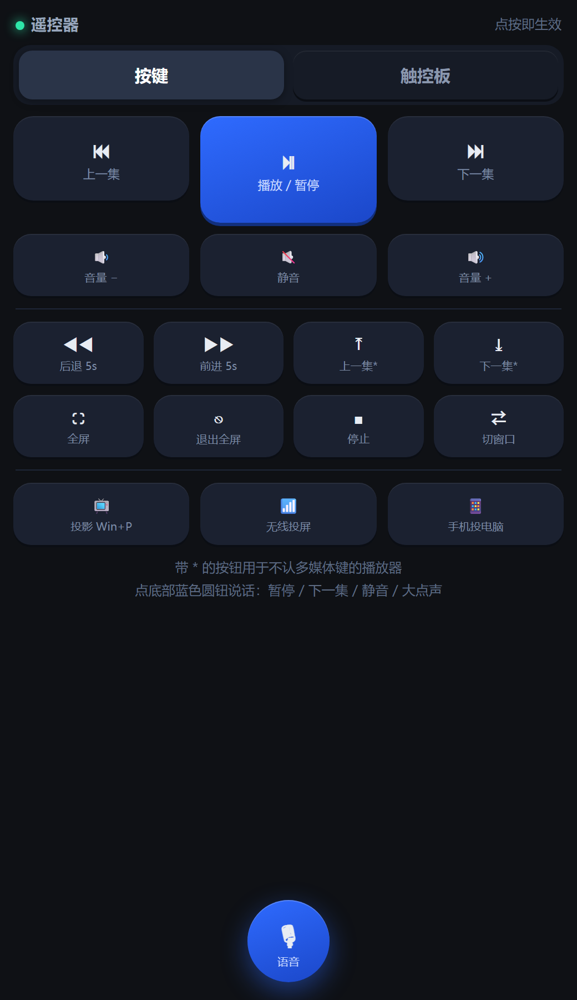
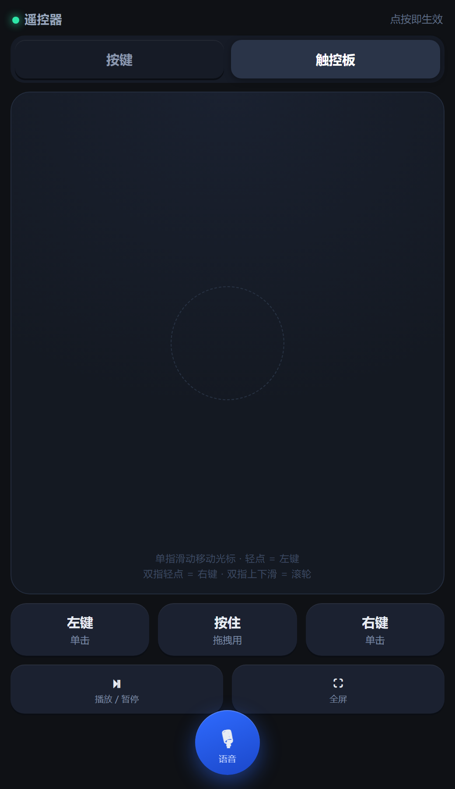

# PC Remote · 手机当电脑遥控器

把 Windows 电脑变成手机可遥控的媒体遥控器：手机浏览器打开一个局域网网页，就能控制视频播放——**不用装 App、不用连云服务、不占 AI Token**，电脑端只需要 Python 标准库。

<p align="center">
  
  &nbsp;&nbsp;
  
</p>

<p align="center">
  <a href="https://github.com/cbfwq/pc-remote/releases/latest"></a>
  
  
  
</p>

## 下载

不想看代码？直接下打包好的：

| 文件 | 给谁 |
|---|---|
| **[pc-remote-v1.0.1-windows.zip](https://github.com/cbfwq/pc-remote/releases/latest)** | **大多数人下这个**。解压后双击 `scripts\\start_hidden.vbs`，包内附中文《使用说明.txt》 |
| [pc-remote-skill-v1.0.1.zip](https://github.com/cbfwq/pc-remote/releases/latest) | 用 WorkBuddy 的人：放到 `~/.workbuddy/skills/` 下即可 |

## 功能

| 模块 | 能力 |
|---|---|
| 按键 | 播放/暂停、上一集/下一集、音量增减/静音、快退/快进、全屏、停止、切换窗口 |
| 投屏 | 打开投影面板（Win+P）、连接无线显示器（Win+K）、投影到此电脑设置 |
| 触控板 | 单指移动光标、轻点=左键、双指轻点=右键、双指滑动=滚轮、按住=拖拽 |
| 语音 | 浏览器识别或手机输入法语音：「暂停」「下一集」「大点声」等直接执行；其它内容当作文字打到电脑光标处 |

原理：向 Windows 发送**系统多媒体键与鼠标事件**，而不是模拟点击播放器界面——所以浏览器全屏视频、PotPlayer、VLC、迅雷影音、电影和电视、音乐软件都通用。

## 快速开始

准备：电脑装 Python 3.9+（勾选 Add to PATH），手机和电脑连同一个 Wi-Fi。

1. 从 [Releases](https://github.com/cbfwq/pc-remote/releases/latest) 下载 `pc-remote-v1.0.1-windows.zip` 并解压（或 Code → Download ZIP）
2. 双击 `scripts\start_hidden.vbs` —— 不会弹任何窗口，这是正常的
3. 打开同目录生成的 `遥控器地址.txt`，把里面的地址（如 `http://192.168.1.5:8765`）输进手机浏览器
4. 建议在手机浏览器菜单里「添加到主屏幕」，之后像 App 一样点开

常用操作：

| 文件 | 用途 |
|---|---|
| `scripts/start_hidden.vbs` | 启动（无窗口） |
| `scripts/start.bat` | 启动（带控制台，调试看报错用） |
| `scripts/stop.bat` | 停止服务 |
| `scripts/setup_autostart.py` | 装 / 卸开机自启 |
| `scripts/遥控器地址.txt` | 每次启动自动写入最新访问地址 |

## 开机自启

```bat
python scripts\setup_autostart.py          :: 静默安装（无窗口）
python scripts\setup_autostart.py --remove :: 取消
```

原理是把一行引导脚本写进当前用户的启动文件夹，由它调用 `start_hidden.vbs` → `pythonw remote.py`。不需要管理员权限、不碰注册表。

## 常见问题

- **手机打不开**：八成是防火墙。Windows 安全中心 → 防火墙 → 允许应用通过防火墙，勾选 `pythonw.exe` 的「专用」。注意放行过 `python.exe` 不代表放行了 `pythonw.exe`。
- **按键没反应但显示已发送**：播放器不认这个键。换集用页面上带 `*` 的 PageUp/PageDown 按钮；方向键/空格只发给前台窗口，先用「切窗口」把播放器切到前面。
- **语音点开没反应**：浏览器只允许在 https 页面用麦克风，手机走局域网 http 会被禁——页面会自动切到输入法语音，这是设计好的降级路径。
- **电脑 IP 变了**：以 `遥控器地址.txt` 里最新一次启动写的地址为准。
- **电脑连不上**：电源设置把「睡眠」改成「从不」，笔记本合盖也设为不休眠。

完整排查手册见 [`docs/troubleshooting.md`](docs/troubleshooting.md)。

## 安全提示

服务在局域网内**无鉴权**，同一 Wi-Fi 下的任何设备都能操作这台电脑（发按键、打字）。家里 Wi-Fi 可以接受；办公室、酒店等公共网络下，用完请运行 `stop.bat` 关掉。

## 用 WorkBuddy 的人

本仓库同时打包成了 WorkBuddy Skill：把 `pc-remote/` 放到 `~/.workbuddy/skills/` 下，重启后说一句「给我装个手机遥控器」即可自动完成安装、验证和开机自启配置。

## License

[MIT](LICENSE)
